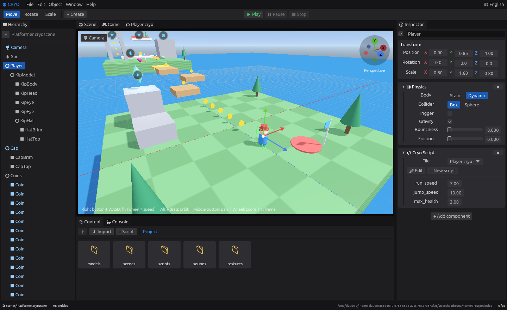
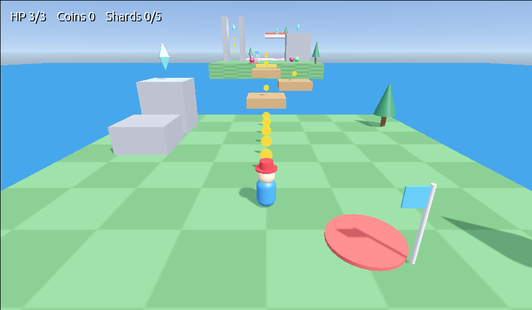
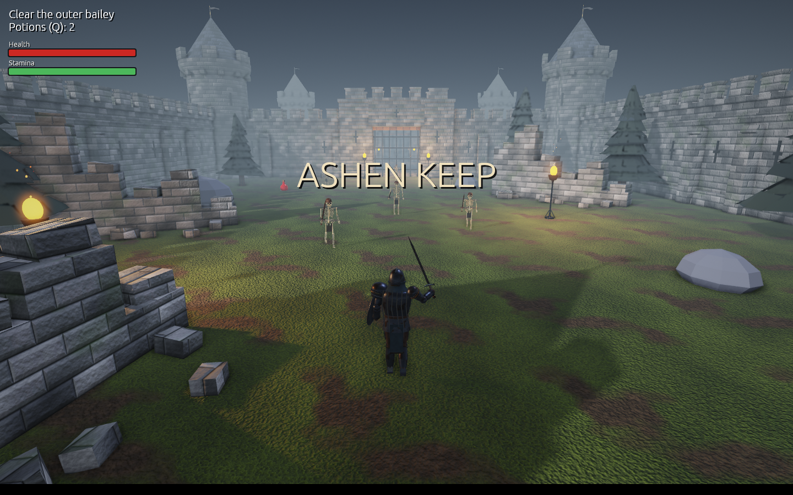
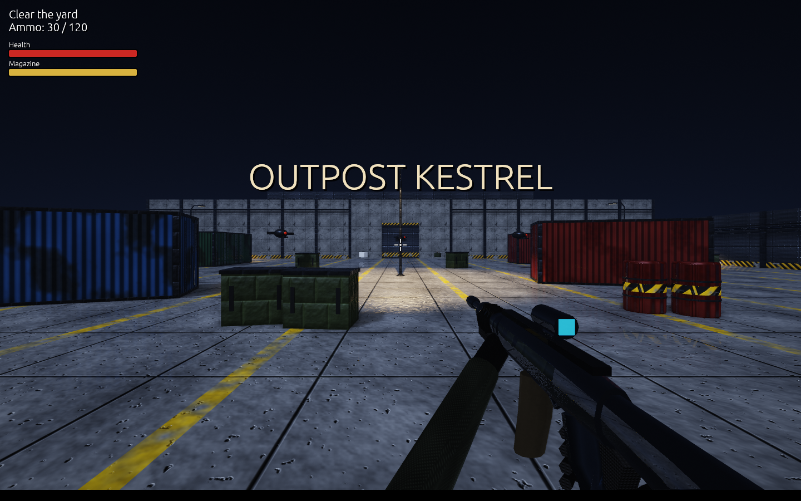

# ❄ Cryo Engine

[](https://github.com/Victor-477/Cryo-Gen/actions/workflows/ci.yml)
[](https://github.com/Victor-477/Cryo-Gen/releases)
[](LICENSE)

A native 3D game engine (Rust + OpenGL) with a Unity/Unreal-style visual editor. Games are scripted in **Cryo**, a small, safe language made for the engine.



**[Documentation](https://victor-477.github.io/Cryo-Gen/)** · **[Download](https://github.com/Victor-477/Cryo-Gen/releases)** · [Run from source](#run-from-source) · [The Cryo language](#the-cryo-language) · [Example game](#example-game-frostpeak-isles)

## Download

Pre-built editors for Windows, macOS and Linux are on the [Releases page](https://github.com/Victor-477/Cryo-Gen/releases). Unzip and run; no installation and no source code needed.

On first launch the editor creates the example project in `~/CryoProjects/FrostpeakIsles` and starts a short welcome tour.

> **macOS:** the app is not signed. The first time, right-click **Cryo Engine.app** and choose **Open**.

## Run from source

Requires [Rust](https://rustup.rs). On Linux, also install `libasound2-dev` (audio).

```bash
git clone https://github.com/Victor-477/Cryo-Gen.git
cd Cryo-Gen
cargo run --release
```

Other ways to start:

```bash
cargo run --release -- path/to/MyGame   # open (or create) a project in that folder
cargo run --release -- --play           # start in Play mode
cargo run --release -- MyGame --game    # run only the game, without the editor
cargo test                              # language, physics, import and example-game tests
```

If you get a graphics configuration error, run with `CRYO_MSAA=0`.

## What is in the box

| | |
|---|---|
| **Editor** | Dockable panels (Hierarchy, Scene, Game, Inspector, Content, Console, script editor), move/rotate/scale gizmos, undo/redo, parent/child entities, Play/Pause/Stop. |
| **Performance** | Skeletal animation runs on the graphics card, objects out of view are skipped, and physics only tests bodies that are near each other. |
| **Rendering** | Primitives and imported models (`.obj`, `.gltf`, `.glb`), physically based materials (roughness, metallic, normal maps), textures with anisotropic filtering, directional/point/spot lights, shadows from the sun and the nearest point lights and spotlights, sky gradient, distance fog, relief lighting, sky reflections. |
| **Post-processing** | Bloom, ambient occlusion, screen-space reflections, filmic tone curve, vignette (per scene). |
| **Physics** | Gravity, box, sphere and triangle-mesh colliders, triggers, contact events with normals, optional rotation (bodies that roll and tip over). |
| **Scripting** | The Cryo language: typed, with maps, `match`, state machines, global events and live error checking. Script properties are editable in the Inspector. |
| **Animation** | Timeline with keyframes, real-time clips started from scripts, cutscenes with camera cuts, and events fired at exact instants. Timers in scripts (`after`, `every`). Skeletal animation from rigged glTF models, with blending between clips. |
| **Quick time events** | `qte.press("e", 1.5)` shows the prompt and answers with `on qte_success` / `on qte_fail`; also mash, hold and sequences, from scripts or from the Timeline. |
| **First person** | One menu item creates a first-person player: mouse look, walk, run, jump. |
| **Modelling** | Edit Mesh mode: select faces or vertices, move, extrude, inset, subdivide, merge, fill; saved as `.obj`. |
| **Audio** | Sound effects, positional sounds and looping music (`.wav`, `.ogg`, `.mp3`). |
| **Effects** | Particles: sparks, smoke, dust, fire, embers, magic, explosions. |
| **Gameplay** | Path finding around obstacles, saving values between sessions. |
| **Camera tools** | Fly, orbit, pan, zoom, trackpad gestures, orthographic axis views, framing, bookmarks. |
| **Export** | One menu item produces a standalone game, for your system or for another one. |
| **Tutorials** | Twelve guided tours inside the editor (Help > Tutorials, or F1). |
| **Languages** | English interface, with Portuguese as a second language (🌐 menu, top right). |

## The Cryo language

Each `.cryo` file defines one `script`, attached to an entity in the Inspector.

```cryo
script Coin {
    prop spin: num = 160            // editable in the Inspector

    on update(dt) {                 // every frame
        self.rotate(vec3(0, spin * dt, 0))
    }

    on collide(other, normal) {     // on contact
        if other.name == "Player" {
            other.send("coin")      // runs `on coin()` in the player's script
            audio.play("sounds/coin.wav")
            self.destroy()
        }
    }
}
```

- **Types:** `num`, `bool`, `text`, `vec3`, `entity`, `list`, `map`, `any`. Annotations are optional and checked when present.
- **Safe by default:** `let` is immutable, conditions must be `bool`, and division by zero, out-of-range indexes, `nil` access and runaway loops become clear errors with a line number. A broken script is disabled; the editor keeps running.

The full reference (syntax, built-in functions and the engine API) is in the [documentation](https://victor-477.github.io/Cryo-Gen/#language).

## Example game: Frostpeak Isles

A small 3D platformer that ships as the default project, built only with editor primitives and a dozen short Cryo scripts. It opens with a cutscene made in the Timeline.



| Move | Keys |
|---|---|
| Run / jump | `WASD` / `Space` |
| Triple jump | three jumps in a row while running |
| Backflip / long jump | `Shift` + `Space` standing still / while running |
| Ground pound | `Shift` in the air |
| Wall jump | jump against a wall, then `Space` |
| Throw the cap | `F` or click; hold to keep it hovering, then jump onto it to bounce |
| Capture | hit a Hopper with the cap to control it; `E` leaves |
| Camera | arrow keys or right-drag, wheel zooms |

Collect the five Frost Shards. Every mechanic is covered by an automated play-through test in `crates/cryo-editor/src/runtime.rs`.

## Example game: Ashen Keep

A medieval hack and slash with one complete level: the outer bailey, the courtyard and the great hall, where the Ashen Warden waits. Create it with **File > New example: Ashen Keep**, or `cargo run --release -- path/to/empty/folder --ashen`.



| Action | Keys |
|---|---|
| Move / look | `WASD` / mouse (`Tab` frees the mouse) |
| Attack (three-hit combo) | left click or `J` |
| Heavy blow | right click or `K` |
| Roll (brief invulnerability) | `Space` |
| Block | hold `Shift` |
| Potion | `Q` |
| Finisher | `F`, when asked |

It shows the engine's newer features working together: rigged, animated characters, state machines in Cryo (`Hero.cryo`, `Enemy.cryo`, `Boss.cryo`), global events that open the gates, HUD bars, a Timeline cutscene and a quick time event to finish the boss. Every model and texture is generated by `tools/make_ashen_assets.py`; the sounds are synthesised. The level is covered by automated play-through tests in `crates/cryo-editor/src/ashen.rs`.

The models are generated from code and textured, with relief painted into the colours. The renderer has textures, coloured lights, shadows and fog, but no PBR materials, normal maps or post-processing, so it is not a match for current big-budget games.

## Example game: Outpost Kestrel

A first-person shooter with one complete level in three sectors: the yard, the warehouse and the reactor room. Create it with **File > New example: Outpost Kestrel**, or `cargo run --release -- path/to/empty/folder --outpost`.



`WASD` moves, the mouse aims, left click fires, `R` reloads, `Shift` runs, `Space` jumps. Clear each sector of security drones to open the next door, then destroy the three coolant nodes of the reactor.

It shows first-person play in the engine: shots are `scene.raycast(...)` rays, drones check line of sight the same way, and the scene uses relief lighting (textures bump the light without normal maps) with coloured point lights at night. Models and textures come from `tools/make_outpost_assets.py`. It uses the post-processing effects (bloom, ambient occlusion, screen-space reflections), shadows from the yard lamps and 1024 x 1024 textures. It is still short of a commercial shooter: the hands have no animated fingers and lighting has no global illumination.

## Repository layout

```
crates/
  cryo-lang/       the Cryo language: lexer, parser, interpreter (no dependencies)
  cryo-editor/
    src/scene.rs     entities, components, .cryoscene (JSON) serialisation
    src/assets.rs    model (.obj, .gltf, .glb) and texture import
    src/render.rs    OpenGL renderer: meshes, textures, lights, shadows, sky, grid
    src/physics.rs   gravity and collisions (oriented boxes and spheres)
    src/audio.rs     sound effects and music
    src/anim.rs      animation clips: tracks, keys, timed events
    src/skel.rs      skeletal animation of rigged glTF models
    src/qte.rs       quick time events
    src/timeline.rs  Timeline panel
    src/mesh_edit.rs editable polygon mesh and modelling operations
    src/meshmode.rs  Edit Mesh mode in the Scene
    src/runtime.rs   Play mode: connects Cryo scripts to the scene
    src/viewport.rs  Scene and Game tabs, editor camera, gizmos, picking
    src/panels.rs    Hierarchy, Inspector, Content, Console, script editor
    src/tutorial.rs  built-in guided tours
    src/i18n.rs      interface languages
    src/project.rs   project on disk, example game, import and export
    src/app.rs       editor state, menus, toolbar, layout
    src/ashen.rs     the Ashen Keep example: level layout, sounds, play-through tests
    src/outpost.rs   the Outpost Kestrel example (first-person shooter)
    template/        scripts and generated assets of the example games
tools/             make_ashen_assets.py: builds the Ashen Keep models and textures
docs/              documentation site (GitHub Pages)
```

## Known limits (0.11.0-beta)

- Skeletal animation: one clip per model at a time (blended when switching), up to 64 joints on the graphics card (more fall back to the CPU); no morph targets.
- Modelling: `.obj` models, one material, automatic texture coordinates. No loop cuts, bevels or booleans yet.
- Models use base colour and base texture; full PBR materials are not read yet.
- Shadows: the first directional light, plus 16 shadow tiles for the nearest local lights (a spotlight uses one, a point light six).
- Lights: 4 directional, and the 16 point/spot lights nearest the camera, per view.
- Physics: mesh colliders are for static bodies; rotating bodies use a simplified model, so stacks of boxes are not stable.
- The macOS app is not signed.
- Script error messages are in English only.

## License

Distributed under the [GNU GPL v3](LICENSE).
