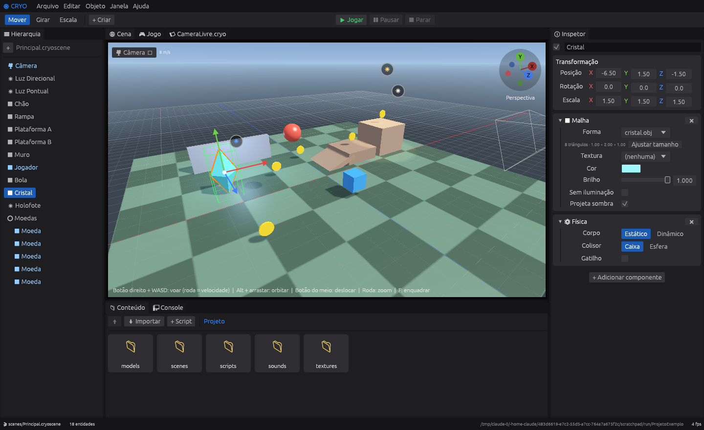

# ❄ Cryo Engine

[](https://github.com/Victor-477/Cryo-Gen/actions/workflows/ci.yml)
[](LICENSE)

Engine 3D nativa (Rust + OpenGL) com editor visual no estilo Unity/Unreal e scripts na linguagem **Cryo**.



**Nesta página:** [Como rodar](#como-rodar) · [O editor](#o-editor) · [A linguagem Cryo](#a-linguagem-cryo) · [Estrutura do código](#estrutura-do-código) · [Limites](#limites-desta-versão-02)

## Como rodar

Requisito: [Rust](https://rustup.rs) instalado.

```bash
git clone https://github.com/Victor-477/Cryo-Gen.git
cd Cryo-Gen
cargo run --release                    # abre (ou cria) ./ProjetoExemplo
```

Outras formas de abrir:

```bash
cargo run --release -- caminho/MeuJogo # abre outro projeto
cargo run --release -- --play          # já inicia em modo Jogo
cargo run --release -- MeuJogo --game  # roda só o jogo, sem o editor
cargo test                             # testes da linguagem, física, importação e do jogo de exemplo
```

Na primeira execução a engine cria um jogo de exemplo (colete as moedas: WASD + Espaço).
Se aparecer erro de configuração gráfica, rode com `CRYO_MSAA=0`.
No Linux, o áudio precisa do pacote `libasound2-dev` para compilar.

## O editor

| Painel | Função |
|---|---|
| **Hierarquia** | Árvore de entidades. Arraste uma sobre outra para criar pai/filho; botão direito para duplicar/excluir. |
| **Cena** | Viewport 3D com grade, seleção por clique, gizmos de mover / girar / escalar e sombras. |
| **Jogo** | O que a câmera do jogo vê. Em modo Jogo, recebe teclado e mouse. |
| **Inspetor** | Transformação e componentes (Malha, Luz, Câmera, Física, Script Cryo). Os `prop` do script aparecem aqui. |
| **Conteúdo** | Arquivos do projeto. Duplo clique abre scripts e cenas, coloca modelos na cena e aplica texturas. |
| **Console** | Saída de `log(...)` e erros de script com número da linha. |
| **Editor de script** | Realce de sintaxe e verificação de erros enquanto você digita. |

Todos os painéis são abas que podem ser arrastadas e reorganizadas (Janela → Restaurar layout padrão).

### Importar modelos, texturas e sons

Arraste os arquivos para a janela, ou use **Conteúdo → Importar** / **Arquivo → Importar**.

| Tipo | Formatos | Vai para |
|---|---|---|
| Modelos 3D | `.obj` (+ `.mtl`), `.gltf`, `.glb` | `models/` |
| Texturas | `.png`, `.jpg` | `textures/` |
| Sons | `.wav`, `.ogg`, `.mp3` | `sounds/` |

Os arquivos que o modelo referencia (materiais, `.bin`, texturas) são copiados junto. Um modelo importado
entra na cena à frente da câmera; se vier em outra unidade (gigante ou minúsculo), a escala é ajustada para ~2 m.
No Inspetor, o componente **Malha** permite trocar o modelo, aplicar uma textura e ajustar o tamanho.
O colisor de caixa usa o volume do modelo e aparece em verde quando o objeto está selecionado.

### Câmera do editor

Tudo fica no menu **🎥 Câmera**, no canto da aba Cena.

| Ação | Mouse | Trackpad (modo "Gestos de trackpad") |
|---|---|---|
| Orbitar | `Alt` + arrastar | dois dedos |
| Deslocar | botão do meio (ou `Alt` + meio) | `Shift` + dois dedos |
| Aproximar | roda, ou `Alt` + botão direito | pinça |
| Voar | botão direito + `WASD` / `Q` `E` (`Shift` acelera) | igual |
| Velocidade de voo | roda enquanto voa | igual |
| Andar sem voar | setas, `PageUp` / `PageDown` | igual |

- **Vistas:** clique nas bolinhas X/Y/Z do indicador de orientação (canto superior direito) para Frente, Direita, Topo e opostas, em projeção ortográfica. `O` alterna perspectiva/ortográfica.
- **Enquadrar:** `F` enquadra a seleção (duplo clique num objeto também), `Home` enquadra a cena toda.
- **Marcadores:** `Ctrl+1..4` salva a posição da câmera, `1..4` volta para ela.
- **Alinhar:** "Alinhar câmera do jogo à vista" (`Ctrl+Shift+F`) leva a câmera do jogo para onde você está olhando; "Alinhar vista ao objeto selecionado" faz o inverso.
- Campo de visão, velocidade e movimento suave são ajustáveis no menu. No macOS o modo trackpad já vem ligado.

Para a câmera **do jogo**, o projeto de exemplo traz três scripts prontos: `CameraSegue` (segue um alvo),
`CameraOrbital` (gira em volta do alvo com o mouse) e `CameraLivre` (voo livre).

### Exportar o jogo

**Arquivo → Exportar jogo…** gera uma pasta (no macOS, um `.app`) com o executável e o projeto dentro.
Esse executável abre direto no jogo, sem o editor; `Esc` fecha. Compile com `--release` antes de exportar.

**Atalhos gerais**

- Ferramentas: `W` mover · `E` girar · `R` escalar
- `Ctrl+P` jogar/parar · `Esc` parar · `Ctrl+S` salvar · `Ctrl+Z` / `Ctrl+Shift+Z` desfazer/refazer · `Ctrl+D` duplicar · `Del` excluir

(no macOS use `Cmd` no lugar de `Ctrl`)

Ao parar o jogo, a cena volta ao estado anterior — como na Unity.

## A linguagem Cryo

Cada arquivo `.cryo` define um `script`, que é anexado a uma entidade pelo Inspetor.

```cryo
script Jogador {
    prop velocidade: num = 6        // aparece no Inspetor
    var moedas = 0                  // estado interno

    on start() {                    // uma vez, ao iniciar
        hud("Moedas: 0")
    }

    on update(dt) {                 // todo quadro
        var v = self.velocity
        v.x = input.axis("horizontal") * velocidade
        if input.pressed("space") and self.grounded {
            v.y = 7
        }
        self.velocity = v
    }

    on collide(outro: entity) {     // contato físico
        log("bati em", outro.name)
    }

    on pegou_moeda() {              // evento próprio: outro.send("pegou_moeda")
        moedas += 1
    }

    fn dobro(x: num) -> num {
        return x * 2
    }
}
```

### Sintaxe

- **Tipos:** `num`, `bool`, `text`, `vec3`, `entity`, `list`, `any`. Anotações são opcionais; quando presentes, são verificadas.
- **Variáveis:** `let` (imutável) e `var` (mutável). Campos do script: `prop` (editável no Inspetor) e `var`.
- **Controle:** `if / else if / else`, `while`, `for i in 0..10`, `for item in lista`, `break`, `continue`, `return`.
- **Operadores:** `+ - * / %`, `== != < <= > >=`, `and or not`, `+= -= *= /=`. `+` junta textos; `vec3` aceita `+ -` entre vetores e `* /` com número.
- **Comentários:** `// ...`. Ponto e vírgula é opcional.

### Seguro por padrão

Erros nunca derrubam o editor: o script com problema é desativado e o Console mostra a linha.

- `let` não pode ser reatribuído; condições precisam ser `bool` (nada de "verdadeiro implícito").
- Divisão por zero, índice fora da lista e acesso a `nil` viram erros claros, não valores inválidos.
- `for x in lista` percorre sem índices (sem erro de "um a mais"); laços infinitos são interrompidos automaticamente.

### API da engine

| | |
|---|---|
| `self` / qualquer `entity` | `.name` `.position` `.rotation` (graus) `.scale` `.color` `.visible` `.velocity` `.grounded` `.forward` `.right` `.up` `.fov` (câmeras) |
| métodos de entidade | `.translate(v)` `.rotate(v)` `.look_at(ponto)` `.distance_to(e)` `.destroy()` `.exists()` `.send("evento", args...)` `.add_physics("dynamic"\|"static", "box"\|"sphere")` |
| `input` | `.axis("horizontal"\|"vertical")` `.down("w")` `.pressed("space")` `.released("e")` — teclas: letras, dígitos, `space`, `enter`, `shift`, `up/down/left/right`, e os botões `mouse_left` `mouse_right` `mouse_middle` · `.mouse_dx` `.mouse_dy` `.scroll` |
| `audio` | `.play("sounds/moeda.wav")` `.play(arquivo, volume)` `.music(arquivo)` (em repetição) `.stop_music()` `.stop()` `.volume` |
| `scene` | `.find("Nome")` (ou `nil`) `.spawn("cube", pos)` `.destroy(e)` `.all()` |
| `time` | `.dt` `.total` |
| saída | `log(...)` no Console · `hud(...)` texto na tela do jogo |
| matemática | `vec3(x,y,z)` `abs sign sin cos tan atan2 sqrt pow floor ceil round min max clamp lerp random` `length normalize dot cross distance` `PI` |
| texto e listas | `str(x)` `num(t)` `len(x)` · `lista.push(x)` `.pop()` `.remove(i)` `.contains(x)` `.clear()` · `t.upper()` `.lower()` `.contains(s)` |

## Estrutura do código

```
crates/
  cryo-lang/     linguagem Cryo: lexer, parser, interpretador (sem dependências)
  cryo-editor/
    src/scene.rs     entidades, componentes, serialização .cryoscene (JSON)
    src/assets.rs    importação de modelos (.obj, .gltf, .glb) e texturas
    src/render.rs    renderizador OpenGL: malhas, texturas, luzes, sombras, céu, grade
    src/physics.rs   gravidade e colisões (caixas orientadas e esferas)
    src/audio.rs     efeitos sonoros e música
    src/runtime.rs   modo Jogo: liga os scripts Cryo à cena
    src/viewport.rs  abas Cena e Jogo, câmera do editor, gizmos, seleção
    src/panels.rs    Hierarquia, Inspetor, Conteúdo, Console, editor de script
    src/project.rs   projeto em disco, importação de arquivos, exportação do jogo
    src/app.rs       estado do editor, menus, barra de ferramentas, layout
    template/        scripts do jogo de exemplo
```

## Limites desta versão (0.2)

- Modelos: malha, cor e textura base. Animações, esqueletos e materiais PBR completos do glTF ainda não são lidos.
- Sombras: só da primeira luz direcional, numa área de ~50 m em volta da câmera.
- Luzes: até 4 direcionais e 16 pontuais/holofotes por cena.
- Física: os corpos colidem com caixas giradas, mas não tombam nem giram ao bater (sem dinâmica de rotação). O colisor de um modelo é a caixa que o envolve, não a malha.
- Exportação: gera o jogo para o sistema em que o editor está rodando (sem compilação cruzada); o `.app` do macOS não é assinado.
- Áudio sem posicionamento 3D.

## Licença

Distribuído sob a [GNU GPL v3](LICENSE).
